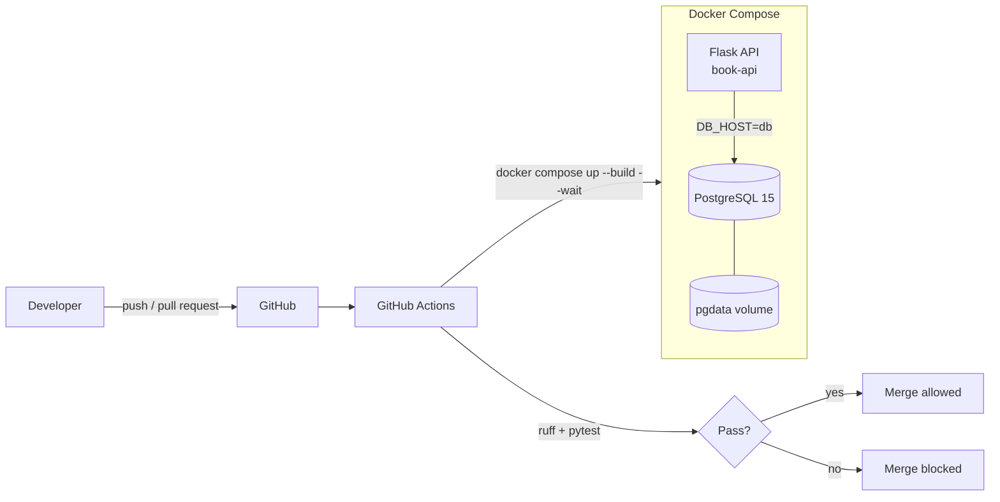

# DevOps Pipeline: Containerized Book API with Automated CI
 

 
A Flask app and REST API backed by PostgreSQL, packaged with Docker and tested automatically on every push and pull request with GitHub Actions. Broken code can't reach `main`: if linting or tests fail, the merge is blocked.
 
## Architecture
 

 
## Tech stack
 
| Area       | Tools                                         |
| ---------- | --------------------------------------------- |
| API        | Python, Flask                                 |
| Database   | PostgreSQL 15                                 |
| Containers | Docker (multi-stage build), Docker Compose    |
| CI         | GitHub Actions                                |
| Quality    | Ruff (linting), PyTest (database, page and REST API tests) |
 
## Endpoints
 
### REST API (JSON)
 
| Method | Endpoint           | Description    | Success | Errors   |
| ------ | ------------------ | -------------- | ------- | -------- |
| GET    | `/api/books`       | List all books | 200     |          |
| GET    | `/api/books/<id>`  | Get one book   | 200     | 404      |
| POST   | `/api/books`       | Add a book     | 201     | 400      |
| PUT    | `/api/books/<id>`  | Update a book  | 200     | 400, 404 |
| DELETE | `/api/books/<id>`  | Delete a book  | 200     | 404      |
 
Example:
 
```bash
curl -X POST http://localhost:5000/api/books \
  -H "Content-Type: application/json" \
  -d '{"name": "Clean Code", "author": "Robert C. Martin", "year": "2008-08-01"}'
```
 
### Web pages
 
| Route          | Description               |
| -------------- | ------------------------- |
| `/`            | List books                |
| `/add`         | Add a book                |
| `/update/<id>` | Update a book             |
| `/delete/<id>` | Delete a book             |
| `/seed`        | Fill the table with sample data |
 
## Run it locally
 
**Requirements:** Docker and Docker Compose.
 
```bash
git clone https://github.com/Bryan652/devops-pipeline.git
cd devops-pipeline
cp .env.example .env        # then fill in your own values
docker compose up --build
```
 
The app runs at **http://localhost:5000**.
 
## Run the tests
 
```bash
docker compose up -d --wait
docker compose exec web pytest -q
docker compose exec web ruff check .
```
 
## CI pipeline
 
On every push and pull request to `main`, GitHub Actions:
 
1. Checks out the code
2. Creates a throwaway `.env` from `.env.ci` (test-only values)
3. Builds and starts the containers with `docker compose up --build -d --wait`
4. Waits for PostgreSQL to report healthy (Compose healthcheck with `pg_isready`)
5. Runs **Ruff** and **PyTest** inside the container
6. Fails the run, and blocks the merge through branch protection, if anything fails
## Design decisions
 
- **Multi-stage Dockerfile:** keeps the final image small by leaving build tools out of the runtime stage.
- **Healthcheck instead of a sleep or wait loop:** Compose only starts the API once PostgreSQL accepts connections, so local runs and CI behave the same.
- **Secrets stay out of Git:** `.env` is ignored; `.env.example` documents the variables and `.env.ci` holds test-only values.
- **Proper HTTP status codes:** the REST API returns 201 on create, 400 on bad input and 404 when a book doesn't exist, so clients can tell what went wrong.
- **Persistent volume:** database data survives container restarts.
## Project structure
 
```
.github/workflows/ci.yml   CI pipeline
API.py                     Flask routes (pages + REST API)
db.py                      Database connection and queries
db_seeder.py               Sample data
main.py                    App entry point
templates/                 index, 404 and 500 pages
test/                      database, page and REST API tests
Dockerfile                 Multi-stage image build
docker-compose.yml         API + PostgreSQL + healthcheck
.env.example / .env.ci     Environment templates
```
 
## Roadmap
 
| Stage | What | Status |
|---|---|---|
| 1 | Containerized Flask app + PostgreSQL, CI with Ruff + PyTest, REST API | ✅ Done |
| 2 | Deploy to AWS with Terraform + continuous deployment | 🚧 Next |
| 3 | Monitoring with Prometheus and Grafana | ⏳ Planned |

```
                                          ⠀⠀⠀⠀⠀⠀⠀⠀⠀⠀⠀⠀⠀⠀⠀⠀⠀⡀⠀⠀⠀⠀⠀⠀⠀⠀⠀⣿⣿⣿⣾⠀
                                          ⠀⠀⠀⠀⠀⠀⠀⠀⠀⢀⠀⢂⠀⠀⠀⠀⠋⠀⠀⠀⠀⠀⠀⠀⠀⠀⠀⣿⣿⣿⣿⠀
                                          ⠀⠀⠀⠀⠀⠀⢀⡈⠛⠦⠀⠀⠀⠆⠀⠀⠀⠀⡀⠀⠐⠀⠀⠀⠀⠀⠀⡛⢱⣿⣿⠀
                                          ⠀⠀⠀⠠⣤⣴⠝⢛⠂⠀⠀⣐⣤⣠⣤⣰⣤⣜⢀⠀⢀⠀⠀⠀⠀⠀⠀⡅⣸⣿⣿⠀
                                          ⠀⠀⠀⠀⢖⣂⠄⡀⣤⣶⣿⣿⣿⣿⣿⣿⣿⣿⣷⣦⡀⠀⠁⠀⠀⠀⠀⣇⣿⣿⣿⠀
                                          ⠀⠀⠀⠀⣤⣶⣾⣿⣿⣿⣿⣿⣿⣿⣿⣿⣿⣿⢿⣿⣿⣶⣦⠀⠀⠀⠀⢹⠹⣿⣿⠀
                                          ⠀⠀⠀⣤⢻⣿⣿⣿⣿⣿⣿⣿⣿⣿⣿⢟⣽⡪⠽⠛⡛⠻⣿⣷⠠⠀⠀⠀⠀⢻⣿⠀
                                          ⠀⠀⠀⢦⣼⣿⣿⣿⣿⣿⣿⣿⣿⣿⣿⠟⠁⣠⣶⣾⣷⣤⡘⢟⡣⠀⠀⠀⠀⠘⣿⠀
                                          ⠀⠀⠀⡞⠿⢿⣿⣿⣿⣿⡿⣿⡿⠋⠀⣠⠾⣻⣽⠾⠻⣿⣿⡜⡷⡀⠀⠀⠀⢶⣿⠀
                                          ⠀⠀⠀⢠⣶⣤⣄⣀⠉⠻⢿⣶⡏⣡⡾⠗⣩⡀⣀⣶⣶⣾⣿⣿⡸⣧⠀⣢⠄⠸⣿⠀
                                          ⠀⠀⠀⠘⣿⠿⠛⠋⠋⠝⡃⣿⣿⣬⡻⣿⣿⣿⣿⣿⣿⣿⣿⣿⣿⡄⢰⡹⣼⠀⢿⠀
                                          ⠀⠀⠀⠀⣯⡰⣗⣴⣾⣿⢡⢹⣿⣎⢷⣽⣿⣿⣿⣿⣿⣿⣿⣿⣿⡁⢸⣛⡟⠀⣾⠀
                                          ⠀⠀⠀⠀⣿⣿⣿⣿⣿⣿⡏⢸⣿⣿⣎⠿⣿⣿⣿⣿⣿⣿⣿⡿⢹⣿⠀⠉⠀⣴⣿⠀
                                          ⠀⠀⠀⠀⠸⣿⣿⣿⣿⣿⡟⣿⣿⣿⣿⣿⡌⣿⣿⣿⣿⣿⡟⢠⣿⣿⠀⠀⠀⠉⢸⠀
                                          ⠀⠀⠀⠀⠀⠹⣿⣿⣿⣿⣏⠌⠋⣩⡶⣒⣵⣿⣿⣿⣿⣿⣷⣿⣿⣿⠀⠀⠀⠀⢸⠀
                                          ⠀⠀⠀⠀⠀⠀⠈⠙⢛⣿⣿⣿⣿⣿⣿⣿⣿⣿⣿⠟⣻⣿⣿⣿⣿⡟⡄⢀⠀⠀⠈⠀
                                          ⠀⠀⠀⠀⠀⠀⠀⠀⠐⢝⢿⣿⡛⢯⡶⢶⣒⣛⣧⣾⢿⣿⣿⣿⡿⢡⣿⠈⢧⡀⠀⠀
                                          ⠀⠀⠀⠀⠀⠀⠀⠀⠀⠀⠈⡐⣶⣾⣿⣿⣿⠿⣻⣻⣿⣿⣿⡿⢡⣿⣿⡇⠆⢧⠀⠀
                                          ⠀⠀⠀⠀⠀⠀⠀⠀⠀⠀⠀⠀⢨⣭⣭⣥⣶⣾⣿⣿⣿⣿⡟⣡⣿⣿⣿⣿⢰⢸⡖⠀
                                          ⠀⠀⠀⠀⠀⠀⠀⠀⠀⢀⢊⡾⡁⠻⣿⣿⣿⣿⣿⣿⣿⠏⣰⣿⣿⣿⣿⣿⣼⡟⣿⠀
                                          ⠀⠀⠀⠀⠀⠀⠀⡠⣠⢳⣧⡺⠁⡄⣝⡻⠿⠿⠿⢛⣡⣾⣿⣿⣿⣿⣿⣿⢻⣧⣿⠀
```
