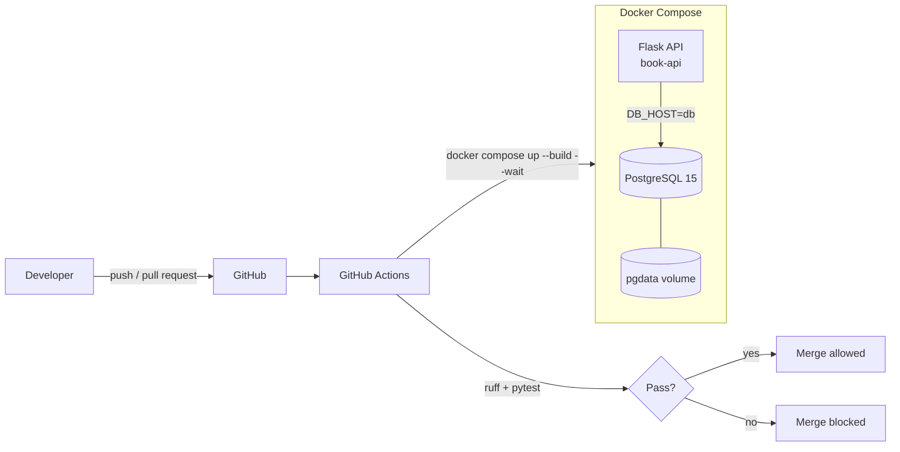

# Containerized Book API with Automated CI


A Flask REST API backed by PostgreSQL, packaged with Docker and tested automatically on every push and pull request with GitHub Actions. Broken code can't reach `main`: if linting or tests fail, the merge is blocked.

## Architecture



## Tech stack

| Area       | Tools                                         |
| ---------- | --------------------------------------------- |
| API        | Python, Flask                                 |
| Database   | PostgreSQL 15                                 |
| Containers | Docker (multi-stage build), Docker Compose    |
| CI         | GitHub Actions                                |
| Quality    | Ruff (linting), PyTest (API + database tests) |

## API endpoints

<!-- Replace with your real routes -->

| Method | Endpoint      | Description    |
| ------ | ------------- | -------------- |
| GET    | `/books`      | List all books |
| GET    | `/books/<id>` | Get one book   |
| POST   | `/books`      | Add a book     |
| PUT    | `/books/<id>` | Update a book  |
| DELETE | `/books/<id>` | Delete a book  |

## Run it locally

**Requirements:** Docker and Docker Compose.

```bash
git clone https://github.com/Bryan652/Containerized-Micro-Service-with-Automated-CI.git
cd Containerized-Micro-Service-with-Automated-CI
cp .env.example .env        # then fill in your own values
docker compose up --build
```

The API runs at **http://localhost:5000**.

Seed sample data (optional):

```bash
docker compose exec web python db_seeder.py
```

## Run the tests

```bash
docker compose up -d --wait
docker compose exec web pytest -q
docker compose exec web ruff check .
```

## CI pipeline

On every push and pull request to `main`, GitHub Actions:

1. Checks out the code
2. Creates a throwaway `.env` from `.env.ci` (test-only values)
3. Builds and starts the containers with `docker compose up --build -d --wait`
4. Waits for PostgreSQL to report healthy (Compose healthcheck with `pg_isready`)
5. Runs **Ruff** and **PyTest** inside the container
6. Fails the run, and blocks the merge through branch protection, if anything fails

## Design decisions

- **Multi-stage Dockerfile:** keeps the final image small by leaving build tools out of the runtime stage.
- **Healthcheck instead of a sleep or wait loop:** Compose only starts the API once PostgreSQL accepts connections, so local runs and CI behave the same.
- **Secrets stay out of Git:** `.env` is ignored; `.env.example` documents the variables and `.env.ci` holds test-only values.
- **Persistent volume:** database data survives container restarts.

## Project structure

```
.github/workflows/ci.yml   CI pipeline
API.py                     Flask routes
db.py                      Database connection
db_seeder.py               Sample data
main.py                    App entry point
templates/                 index, 404 and 500 pages
test/                      test_api.py, test_db.py
Dockerfile                 Multi-stage image build
docker-compose.yml         API + PostgreSQL + healthcheck
.env.example / .env.ci     Environment templates
```

```
                                          ⠀⠀⠀⠀⠀⠀⠀⠀⠀⠀⠀⠀⠀⠀⠀⠀⠀⡀⠀⠀⠀⠀⠀⠀⠀⠀⠀⣿⣿⣿⣾⠀
                                          ⠀⠀⠀⠀⠀⠀⠀⠀⠀⢀⠀⢂⠀⠀⠀⠀⠋⠀⠀⠀⠀⠀⠀⠀⠀⠀⠀⣿⣿⣿⣿⠀
                                          ⠀⠀⠀⠀⠀⠀⢀⡈⠛⠦⠀⠀⠀⠆⠀⠀⠀⠀⡀⠀⠐⠀⠀⠀⠀⠀⠀⡛⢱⣿⣿⠀
                                          ⠀⠀⠀⠠⣤⣴⠝⢛⠂⠀⠀⣐⣤⣠⣤⣰⣤⣜⢀⠀⢀⠀⠀⠀⠀⠀⠀⡅⣸⣿⣿⠀
                                          ⠀⠀⠀⠀⢖⣂⠄⡀⣤⣶⣿⣿⣿⣿⣿⣿⣿⣿⣷⣦⡀⠀⠁⠀⠀⠀⠀⣇⣿⣿⣿⠀
                                          ⠀⠀⠀⠀⣤⣶⣾⣿⣿⣿⣿⣿⣿⣿⣿⣿⣿⣿⢿⣿⣿⣶⣦⠀⠀⠀⠀⢹⠹⣿⣿⠀
                                          ⠀⠀⠀⣤⢻⣿⣿⣿⣿⣿⣿⣿⣿⣿⣿⢟⣽⡪⠽⠛⡛⠻⣿⣷⠠⠀⠀⠀⠀⢻⣿⠀
                                          ⠀⠀⠀⢦⣼⣿⣿⣿⣿⣿⣿⣿⣿⣿⣿⠟⠁⣠⣶⣾⣷⣤⡘⢟⡣⠀⠀⠀⠀⠘⣿⠀
                                          ⠀⠀⠀⡞⠿⢿⣿⣿⣿⣿⡿⣿⡿⠋⠀⣠⠾⣻⣽⠾⠻⣿⣿⡜⡷⡀⠀⠀⠀⢶⣿⠀
                                          ⠀⠀⠀⢠⣶⣤⣄⣀⠉⠻⢿⣶⡏⣡⡾⠗⣩⡀⣀⣶⣶⣾⣿⣿⡸⣧⠀⣢⠄⠸⣿⠀
                                          ⠀⠀⠀⠘⣿⠿⠛⠋⠋⠝⡃⣿⣿⣬⡻⣿⣿⣿⣿⣿⣿⣿⣿⣿⣿⡄⢰⡹⣼⠀⢿⠀
                                          ⠀⠀⠀⠀⣯⡰⣗⣴⣾⣿⢡⢹⣿⣎⢷⣽⣿⣿⣿⣿⣿⣿⣿⣿⣿⡁⢸⣛⡟⠀⣾⠀
                                          ⠀⠀⠀⠀⣿⣿⣿⣿⣿⣿⡏⢸⣿⣿⣎⠿⣿⣿⣿⣿⣿⣿⣿⡿⢹⣿⠀⠉⠀⣴⣿⠀
                                          ⠀⠀⠀⠀⠸⣿⣿⣿⣿⣿⡟⣿⣿⣿⣿⣿⡌⣿⣿⣿⣿⣿⡟⢠⣿⣿⠀⠀⠀⠉⢸⠀
                                          ⠀⠀⠀⠀⠀⠹⣿⣿⣿⣿⣏⠌⠋⣩⡶⣒⣵⣿⣿⣿⣿⣿⣷⣿⣿⣿⠀⠀⠀⠀⢸⠀
                                          ⠀⠀⠀⠀⠀⠀⠈⠙⢛⣿⣿⣿⣿⣿⣿⣿⣿⣿⣿⠟⣻⣿⣿⣿⣿⡟⡄⢀⠀⠀⠈⠀
                                          ⠀⠀⠀⠀⠀⠀⠀⠀⠐⢝⢿⣿⡛⢯⡶⢶⣒⣛⣧⣾⢿⣿⣿⣿⡿⢡⣿⠈⢧⡀⠀⠀
                                          ⠀⠀⠀⠀⠀⠀⠀⠀⠀⠀⠈⡐⣶⣾⣿⣿⣿⠿⣻⣻⣿⣿⣿⡿⢡⣿⣿⡇⠆⢧⠀⠀
                                          ⠀⠀⠀⠀⠀⠀⠀⠀⠀⠀⠀⠀⢨⣭⣭⣥⣶⣾⣿⣿⣿⣿⡟⣡⣿⣿⣿⣿⢰⢸⡖⠀
                                          ⠀⠀⠀⠀⠀⠀⠀⠀⠀⢀⢊⡾⡁⠻⣿⣿⣿⣿⣿⣿⣿⠏⣰⣿⣿⣿⣿⣿⣼⡟⣿⠀
                                          ⠀⠀⠀⠀⠀⠀⠀⡠⣠⢳⣧⡺⠁⡄⣝⡻⠿⠿⠿⢛⣡⣾⣿⣿⣿⣿⣿⣿⢻⣧⣿⠀
```
